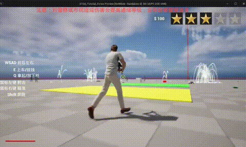
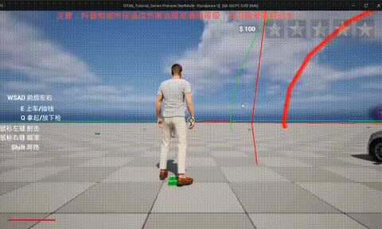

# GTA6 Core Logic from Scratch

**It's a GTA6 core logic maked from scratch during pre-agent era**

A third-person open-world sandbox prototype built in **Unreal Engine 5.3** with Blueprints — driving, gunplay, police AI and a GTA-style wanted system, implemented from scratch.

▶ **[Watch the full demo (53 s, with audio)](docs/media/demo.mp4)**

## Demo

<table>
  <tr>
    <td width="50%"></td>
    <td width="50%"></td>
  </tr>
  <tr>
    <td width="50%"></td>
    <td width="50%"></td>
  </tr>
</table>

## Features

- **Third-person character** — locomotion, sprint, aim down sights, fire
- **Weapon handling** — rifle equip / holster, firing, projectile trajectory preview
- **Vehicles** — enter / exit cars and drive with Chaos Vehicle physics
- **Wanted system** — 5-star meter that rises when you harm police or civilians, followed by a police chase and a *Wasted* screen
- **Economy** — cash pickups in the world, banked balance in the HUD

## Controls

| Input | Action |
| --- | --- |
| `W` `A` `S` `D` | Move |
| `Shift` | Sprint |
| `E` | Enter vehicle / pick up cash |
| `Q` | Equip / holster rifle |
| Right mouse | Aim |
| Left mouse | Fire |

## Tech

- Unreal Engine 5.3, Blueprint gameplay framework
- Enhanced Input System
- Chaos Vehicles for driving
- MetaHuman characters and City Sample vehicles
- UI built with UMG (`WB_HUD`, `WB_Wanted`, `WB_BankCash`, `WB_Wasted`)

## Running

The project stores binary assets with **Git LFS**, so install it first:

```bash
git lfs install
git clone https://github.com/lorenzozanee/GTA6_Core_Logic_from_scratch.git
```

Then open `GTA6_Tutorial_Series.uproject` with **Unreal Engine 5.3** and play the `Test` map in Standalone mode.
